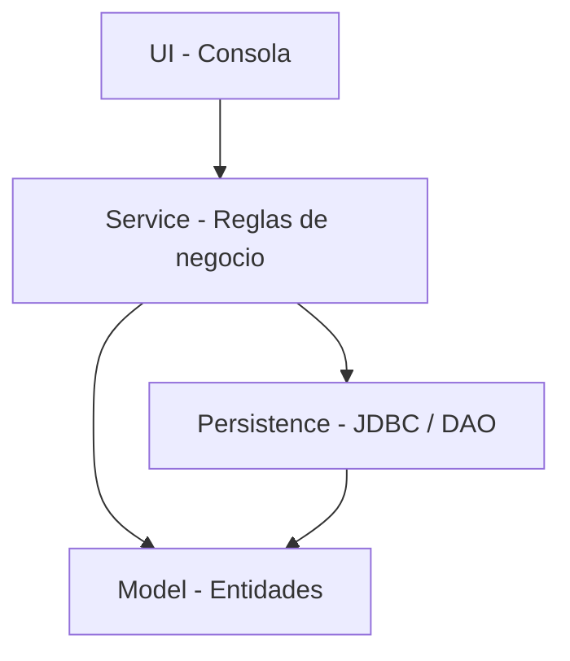

# Arquitectura inicial

**Estado:** propuesta de diseño para revisión del equipo.  
**Objetivo:** mantener responsabilidades separadas y permitir que los tres integrantes trabajen en módulos diferentes sin duplicar lógica.

## 1. Capas

### Model

Representa los conceptos del negocio y sus reglas propias: productos, presentaciones, clientes, ventas, cuentas por cobrar y movimientos de dinero. No debe mostrar menús ni ejecutar consultas SQL.

### Persistence

Contiene las clases responsables de leer y guardar datos en PostgreSQL mediante JDBC. Las clases de acceso a datos (DAO o repositorios) encapsulan las consultas y la conversión entre filas de la base de datos y objetos del modelo.

### Service

Coordina las operaciones del negocio. Valida reglas que involucran varias entidades, como verificar existencias antes de registrar una venta, calcular su total y actualizar el inventario de manera consistente.

### UI

Contiene el menú de consola para la entrega inicial. Lee entradas del usuario, solicita operaciones a los servicios y presenta mensajes en español. La UI no construye consultas SQL ni modifica directamente el modelo persistido.

## 2. Dependencias permitidas



El modelo no debe depender de la interfaz, los servicios ni la persistencia. La UI solicita operaciones a Service; Persistence encapsula el acceso a PostgreSQL.

## 3. Paquetes propuestos

```text
src/main/java/com/laexclusiva/
├── Main.java
├── model/
├── persistence/
├── service/
└── ui/
    └── ConsoleMenu.java

database/
├── schema.sql
└── seed.sql

docs/
├── fase-1/
└── fase-2/
```

El menú y el punto de entrada ya existen como estructura inicial. Los paquetes y los scripts de base de datos se incorporarán cuando se apruebe el diseño mínimo. No crear clases vacías ni scripts definitivos antes de acordar sus responsabilidades.

## 4. Persistencia y configuración

Se usará PostgreSQL mediante JDBC. La configuración de conexión debe obtenerse desde variables de entorno o una configuración local excluida de Git. Ninguna contraseña debe aparecer en el código, el README o los commits.

Los scripts de creación de tablas y datos de prueba se almacenarán en database cuando el modelo inicial de datos se haya revisado. Los archivos SQL sí deben quedar versionados; los datos reales sensibles y las credenciales no.

## 5. Contratos entre módulos

Antes de implementar en paralelo, el equipo debe acordar:

- Identificadores y campos esenciales del producto.
- Cómo se representa una presentación y cómo se convierte a unidades de inventario.
- Cómo se representa una venta con sus líneas.
- Cómo una venta a crédito origina una cuenta por cobrar.
- Cómo se registra un abono y cómo se obtiene el saldo.
- Qué operaciones públicas ofrece cada servicio.
- Cómo se controlan las transacciones para evitar que una venta quede guardada sin su actualización de inventario.

## 6. Pruebas mínimas de integración

1. Registrar un producto y consultarlo después de reiniciar la aplicación.
2. Registrar una venta con dos referencias y comprobar el total.
3. Verificar que las existencias se reducen correctamente.
4. Intentar vender más unidades de las disponibles y comprobar que no se modifica el inventario.
5. Registrar una venta a crédito y un abono, y comprobar el saldo pendiente.

## 7. Decisiones abiertas

La arquitectura por capas se mantiene como referencia inicial siguiendo el trabajo realizado en GameZone. Las clases, sus atributos, sus métodos y las relaciones definitivas deberán documentarse en el diagrama de clases después de validar los requerimientos críticos.
